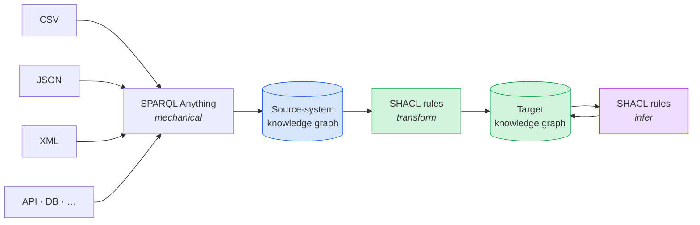

<div class="bn-cover-panel">

<div class="flex items-center gap-3 mb-8">
  
  <span class="text-xl font-bold">Matdata</span>
  <span class="opacity-60 mx-1">×</span>
  
</div>

# Building the Norwegian Railway Knowledge Graph

## SPARQL Anything in production, and what we would do differently

<div class="mt-8 opacity-90 text-sm">
Mathias Vanden Auweele · Matdata<br>
with the Bane NOR DIM use case<br>
ISWC 2026 · Façade-X tutorial · Bari
</div>

</div>

<!--
[0:15] Hi, I'm Mathias from Matdata. For twenty minutes I'll show you a railway knowledge graph that runs in production on SPARQL Anything, and the one thing I'd do differently if I started today.
-->

---
layout: two-cols-header
---

# Who, what, and what to take home

::left::

<div class="pr-6 text-sm">

<div class="flex items-center gap-2 mb-2">
  
  <span class="text-2xl font-bold">Matdata</span>
</div>

One-person consultancy for semantic mapping and knowledge graphs in rail.
Working with **Bane NOR** (Norway's infrastructure manager) on the
**Digital Infrastructure Model (DIM)**.


<div class="text-xs opacity-60 mt-2">A Bane NOR use case, presented by Matdata.</div>

</div>

::right::

<div class="pl-6 border-l border-gray-400/40">

<div class="text-sm uppercase tracking-wide opacity-60">Take-home messages</div>

<div class="text-xl mt-3 leading-snug">
A knowledge graph <b>can serve production systems</b>: DIM feeds ETCS engineering, train operators and the EU register today.
</div>

<div class="text-xl mt-4 leading-snug">
To get there: use SPARQL Anything to <b>triplify the source</b>, then <b>transform and enrich with rules</b>.
</div>

</div>

<!--
[0:45] Matdata is me. I work with Bane NOR, the Norwegian infrastructure manager, on their Digital Infrastructure Model, DIM.
Two things to take home. First: a knowledge graph serving production systems is a valid case, not a research toy. DIM feeds ETCS engineering, train operators and the EU register today.
Second, how to get there: use SPARQL Anything to turn the source into RDF, nothing more, and do the mapping to your target model, and the enrichment for your users, in a second step with rules.
-->

---
layout: center
---

<LightOrDark>
  <template #light>
    
    
  </template>
  <template #dark>
    
    
  </template>
</LightOrDark>

<div v-click class="absolute bottom-8 left-0 right-0 text-center text-xl">
The goal: <b>one authoritative model</b> of the railway infrastructure, serving every use case.
</div>

<!--
[1:15] One railway, many domains depending on the same infrastructure data: maintenance, projects, operations, timetabling, stakeholders.
(click) Historically every domain built its own silo, with its own copy of the railway. Sometimes you'd think it was a different railway.
(click) DIM's strategic goal is one authoritative model of the infrastructure, as a knowledge graph, that every use case draws from.
-->

---

# Proof of concept, pilot, or production?

<div class="flex items-stretch gap-2 mt-8 text-center">
  <div class="flex-1 rounded-lg border border-gray-400/40 p-3 opacity-50">
    <div class="font-bold">Proof of concept</div>
    <div class="text-xs mt-1">"It can be done"</div>
  </div>
  <div class="self-center opacity-50">→</div>
  <div class="flex-1 rounded-lg border border-gray-400/40 p-3 opacity-50">
    <div class="font-bold">Pilot</div>
    <div class="text-xs mt-1">One team, one use case</div>
  </div>
  <div class="self-center opacity-50">→</div>
  <div class="flex-1 rounded-lg border-2 border-green-500 bg-green-500/10 p-3">
    <div class="font-bold text-green-600">Production ✓</div>
    <div class="text-xs mt-1">Others depend on it</div>
  </div>
  <div class="self-center opacity-50">→</div>
  <div class="flex-1 rounded-lg border-2 border-dashed border-blue-500 p-3">
    <div class="font-bold text-blue-500">Foundation</div>
    <div class="text-xs mt-1">The base for traffic systems</div>
  </div>
</div>

<div class="mt-8" />

<v-clicks>

- Railway is a slow business: processes inside an infrastructure manager don't change overnight.
- Still: **the ERTMS programme uses DIM as its starting point** to implement ETCS on the lines.
- DIM is **strategically chosen as the successor** for supplying infrastructure data to traffic management, traffic planning and timetabling.

</v-clicks>

<!--
[1:15] When someone at a conference says "we use SPARQL Anything", you should ask: is that a proof of concept, a pilot, or production? It makes a big difference.
Railway is a slow business. Processes inside a company don't change fast. But DIM is in production.
(click) The ERTMS programme, the European train control system rollout, uses DIM as the first starting point to implement ETCS on the line. That's a major dependency.
(click) And DIM has been chosen strategically as the successor of the systems that supply infrastructure data to traffic management, traffic planning and timetabling. It will be the foundation for those use cases.
-->

---

# Who relies on it today

<div class="grid grid-cols-3 gap-5 mt-8">

<div class="rounded-lg border-t-4 border-blue-500 bg-blue-500/5 p-4">
<div class="text-xs uppercase tracking-wide text-blue-500 font-bold">ERTMS</div>
<div class="mt-2 text-sm">Starting point for implementing <b>ETCS</b> on the lines.</div>
</div>

<div class="rounded-lg border-t-4 border-amber-500 bg-amber-500/5 p-4">
<div class="text-xs uppercase tracking-wide text-amber-500 font-bold">Railway undertakings</div>
<div class="mt-2 text-sm"><b>Platform lengths</b>: which trains fit, and when to tell passengers to move forward or back.</div>
</div>

<div class="rounded-lg border-t-4 border-green-500 bg-green-500/5 p-4">
<div class="text-xs uppercase tracking-wide text-green-600 font-bold">RINF</div>
<div class="mt-2 text-sm">The EU <b>Register of Infrastructure</b> obligation, generated from the graph. First submission at <b>micro (topology) level</b>.</div>
</div>

</div>

<!--
[0:45] Three kinds of consumers today. ERTMS, as I said. Railway undertakings, the train operators: they use our platform lengths to know which trains fit, and whether passengers need to move forward or backward. And RINF, the EU Register of Infrastructure, which every infrastructure manager must report to. We generate it straight from the graph, and it was the first submission at micro, topology, level.
-->

---

# What is inside

<div class="grid grid-cols-4 gap-4 mt-8">
  <div class="rounded-lg bg-blue-500/10 p-4 text-center">
    <div class="text-3xl font-bold text-blue-500">~13M</div>
    <div class="text-sm opacity-80 mt-1">triples</div>
  </div>
  <div class="rounded-lg bg-green-500/10 p-4 text-center">
    <div class="text-3xl font-bold text-green-500">17</div>
    <div class="text-sm opacity-80 mt-1">ontologies</div>
  </div>
  <div class="rounded-lg bg-amber-500/10 p-4 text-center">
    <div class="text-3xl font-bold text-amber-500">5,000+</div>
    <div class="text-sm opacity-80 mt-1">km of track</div>
  </div>
  <div class="rounded-lg bg-purple-500/10 p-4 text-center">
    <div class="text-3xl font-bold text-purple-500">~40</div>
    <div class="text-sm opacity-80 mt-1">asset types</div>
  </div>
</div>

<div class="mt-10 text-lg text-center">
<b>Topology-based</b>: every asset is positioned on the network graph, not just on a map.
</div>

<div class="mt-4 text-sm text-center opacity-70">
Outputs: railML 3.2 / 3.3 · SPARQL endpoint · JSON-LD REST API · RINF · end-to-end run under 3 hours
</div>

<div class="abs-bl m-6 text-xs opacity-50">Figures from Vanden Auweele et al., Sem4Tra 2026.</div>

<!--
[0:45] Some numbers, the ones we published in the Sem4Tra paper. About 13 million triples, 17 ontologies, more than five thousand kilometres of track, about 40 asset types.
One sentence on why railway is special: it is topology-based. Every signal, every balise is positioned on the network graph, not just as a point on a map.
-->

---
layout: full
---

<Clip full src="/assets/dim-data.webm" poster="/assets/dim-data.png" caption="DIM portal · railML files per subnetwork · datasets in RDF, JSON-LD and CSV · key figures from the graph" />

<!--
[0:35] This is the DIM web portal. Everything you see comes from the knowledge graph: railML files for each subnetwork, the datasets themselves in RDF, JSON-LD and CSV, and key figures computed from the graph.
-->

---
layout: full
---

<Clip full src="/assets/dim-tps.webm" poster="/assets/dim-tps.png" caption="TPS mapping · DIM netelements linked to the timetable-planning topology, both maps in sync" />

<!--
[0:30] The TPS mapping: we link the topology of the timetable planning system to ours. Hover a netelement on our map and its counterpart lights up in the TPS schematic, and the other way round.
-->

---
layout: full
---

<Clip full src="/assets/dim-tools.webm" poster="/assets/dim-tools.png" caption="Search builder on Sparnatural: point-and-click SPARQL · data catalog of what each dataset contains" />

<!--
[0:45] The tools. The search builder integrates Sparnatural, so people can build SPARQL queries by clicking, without knowing SPARQL. And the data catalog documents what is in each dataset and where it comes from.
-->

---

# A REST API that is secretly a knowledge graph

<div class="grid grid-cols-2 gap-6 mt-2">


<div>

<v-clicks>

- A **conventional REST API**, documented with **Swagger / OpenAPI**
- Responses are **JSON-LD**
- Built **from the knowledge graph**, with some indexing in the backend
- Developers get clean JSON; the data stays linked

</v-clicks>

</div>

</div>

<!--
[1:00] This is the part I find most interesting for this audience. Most developers don't want SPARQL. So we offer a conventional REST API, documented with Swagger. (click) But the responses are JSON-LD, (click) constructed from the knowledge graph, with a bit of indexing in the backend so it is fast. (click) So people interact with the knowledge graph in the way they're used to, through JSON files, and still get linked data.
-->

---
layout: full
---

<Clip full src="/assets/rinf-atlas.webm" poster="/assets/rinf-atlas.png" caption="RINF Atlas (rinf-atlas.matdata.eu) · open source · Europe down to the tracks, switches and signals of Oslo S, generated from DIM" />

<!--
[0:45] And RINF Atlas, which I open sourced. It shows what is inside the European RINF knowledge graph. Here we zoom from Europe into Oslo Central, where you can see the micro level: tracks, switches, signals, all generated from DIM.
-->

---
layout: section
---

# Why SPARQL Anything,<br>and what I would do differently

<!--
So that's the project, and it is real. Now: why SPARQL Anything, and what I'd do differently.
-->

---

# Why SPARQL Anything, and which ontology

<div class="grid grid-cols-2 gap-8 mt-2">

<div>

**One language.** The team was new to knowledge graphs. We had to learn SPARQL for querying anyway, so why learn a second mapping language?

<div class="mt-4 text-sm opacity-80">Sources: CSV, XML, GeoPackage (via CSV export)</div>

</div>

<div class="text-sm">

| Requirement | railML 3 | ERA |
|---|:--:|:--:|
| Native ontology | ○ | ● |
| RINF compatibility | ◑ | ● |
| Proven industrial adoption | ● | ◑ |
| Detailed asset catalogue | ◕ | ◔ |
| Timetable management | ◕ | ○ |
| ETCS data exchange | ◕ | ○ |

<div class="text-xs opacity-60 mt-1">● full ◕ good ◑ partial ◔ limited ○ none</div>

</div>

</div>

<div class="mt-4 grid grid-cols-2 gap-6 text-sm">
<div class="p-3 rounded-lg bg-green-500/10"><b>railML 3</b> as the internal backbone: it covers the most proven use cases.</div>
<div class="p-3 rounded-lg bg-blue-500/10"><b>ERA ontology</b> as an export target for RINF.</div>
</div>

<!--
[1:30] Why SPARQL Anything? Our team was new to knowledge graphs. We had to learn SPARQL to query the graph anyway, so why learn R2RML or RML on top? One language for mapping and querying.
And which ontology? The model that covers the most proven use cases wins. ERA is native RDF and mandated for RINF, but railML covers far more of what we need today: asset catalogue, timetabling, ETCS data exchange. So railML is the backbone, ERA is an export target.
-->

---

# What we did first: straight into the target

<div class="grid grid-cols-5 gap-6">

<div class="col-span-3">

```sparql {all|10-15|1-8|all}
CONSTRUCT {
  ?balise a railml3:Balise, rtm:NetEntity ;
    rdfs:label ?label ;
    rtm:hasSpotLocation ?loc .
  ?loc a rtm:SpotLocation ;
    rtm:onNetElement ?netelement ;
    rtm:hasIntrinsicCoordinate ?coord .
}
WHERE {
  SERVICE <x-sparql-anything:location=
      balises.csv,csv.headers=true> {
    ?s xyz:atb_banedata_id ?id ;
       xyz:name ?label ;
       xyz:measure_on_link ?coord .
  }
  BIND(IRI(CONCAT(STR(bnd:),
      "_balise_", STR(?id))) AS ?balise)
}
```

</div>

<div class="col-span-2 text-sm">

- One `CONSTRUCT` per source file and asset type
- Reads the CSV through Façade-X…
- …and writes **railML / RTM** triples directly

<div v-click class="mt-6 p-3 rounded-lg bg-amber-500/10">
Fine for one file. But real mappings span files, need geometry, and need fixes to the source data.
</div>

</div>

</div>

<!--
[1:00] This is how we started. One CONSTRUCT per source file. (click) The SERVICE clause reads the CSV through Façade-X, (click) and the CONSTRUCT writes railML and RTM triples directly. Source to target in one step.
(click) That's fine for one file. But real mappings span several files, need geometry, and need fixes to the source data. Here's what that did to us.
-->

---

# The mess that followed

<div class="mess text-xs mt-1">
  <div class="row fixes">
    <div /><div v-click="1" class="box amber">~100 SQL data patches<br><span class="opacity-70">+ spatial SQL views</span></div><div /><div /><div /><div />
  </div>
  <div class="row arrows"><div /><div v-click="1">⇣</div><div /><div /><div /><div /></div>
  <div class="row main">
    <div class="box">Source<br><span class="opacity-70">GeoPackage</span></div>
    <div class="box">Source Ingestor<br><span class="opacity-70">CSV export</span></div>
    <div class="box blue">SPARQL Anything<br><span class="opacity-70">~50 CONSTRUCTs</span></div>
    <div class="box">Jena Fuseki</div>
    <div class="box">Split<br><span class="opacity-70">15 queries</span></div>
    <div class="box">railML · RINF<br>API</div>
  </div>
  <div class="row arrows"><div /><div /><div /><div v-click="3">⇡</div><div v-click="2">⇖</div><div /></div>
  <div class="row fixes">
    <div /><div /><div /><div v-click="3" class="box red">61 post-processing<br><span class="opacity-70">SPARQL UPDATEs</span></div><div v-click="2" class="box red">6 Python steps<br><span class="opacity-70">geometry · tracks</span></div><div />
  </div>
</div>

<style>
.mess .row { display: grid; grid-template-columns: repeat(6, 1fr); gap: .9rem; align-items: center; }
.mess .main .box + .box { position: relative; }
.mess .main .box + .box::before { content: '→'; position: absolute; left: -.85rem; top: 50%; transform: translateY(-50%); opacity: .6; }
.mess .arrows > div { text-align: center; font-size: 1.2rem; line-height: 1.4; opacity: .7; }
.mess .box { border: 1px solid rgba(128,128,128,.45); border-radius: .4rem; padding: .45rem .5rem; text-align: center; line-height: 1.25; }
.mess .blue { background: rgba(59,130,246,.12); border-color: #3b82f6; }
.mess .amber { background: rgba(245,158,11,.14); border-color: #d97706; }
.mess .red { background: rgba(239,68,68,.12); border-color: #dc2626; }
</style>

<div class="grid grid-cols-3 gap-4 mt-5 text-xs">
<div v-click="1" class="rounded bg-amber-500/10 p-3"><b>Data patches</b> in SQL, because source fixes take months and must land before anything else reads the data.</div>
<div v-click="2" class="rounded bg-red-500/10 p-3"><b>GeoSPARQL gaps</b>: no linear referencing, no routing, not even <code>ST_X</code>. Engines don't implement the full spec, so geometry moves to SQL and Python.</div>
<div v-click="3" class="rounded bg-red-500/10 p-3"><b>Post-processing</b>: dozens of ordered UPDATEs. An imperative program in SPARQL, with no lineage.</div>
</div>

<!--
[2:00] This is what grew around that simple CONSTRUCT. SPARQL Anything doesn't read databases, so a Source Ingestor exports CSV.
(click) Data quality issues in the source take months to fix upstream, so we patch in SQL: about a hundred patches, and they must run before anything else reads the data.
(click) GeoSPARQL is geometry-centric. No linear referencing, no routing, not even a function to get the X coordinate. And many engines don't implement the full spec. So spatial logic went into SpatiaLite SQL and six Python steps.
(click) And because mappings span files, 61 post-processing UPDATEs run in a fixed order. That's an imperative program written in SPARQL. Nobody can tell you which rule produced which triple.
-->

---

# What it costs

<div class="grid grid-cols-2 gap-8 mt-4">

<div class="text-sm">

| Pipeline stage | Time |
|---|--:|
| Source ingestion (SpatiaLite → CSV) | 3.5 min |
| **SPARQL Anything mapping** | **10 min** |
| Post-processing (UPDATEs) | 45 min |
| Splitting (15 sequential queries) | 1 h 30 |
| railML generation | 15 min |
| RINF with maplib SHACL rules | 10 min |
| RINF with TopBraid SHACL rules | 2 h |

<div class="text-xs opacity-60 mt-1">Full production run, one worker (1–4 vCPU, 28–32 GiB). The two RINF rows are alternatives.</div>

</div>

<div class="flex flex-col justify-center gap-4 text-sm">
<div class="p-4 rounded-lg bg-green-500/10"><b>SPARQL Anything is not the bottleneck.</b> Triplifying everything takes 10 minutes.</div>
<div class="p-4 rounded-lg bg-amber-500/10"><b>The fix-up layers are.</b> Post-processing and splitting take over two hours.</div>
<div class="p-4 rounded-lg bg-purple-500/10"><b>Rules can be fast.</b> maplib runs the same SHACL rules in 10 minutes vs 2 hours.</div>
</div>

</div>

<!--
[0:45] What does it cost? SPARQL Anything itself takes ten minutes for everything. It's not the problem.
The fix-up layers are: post-processing and splitting take over two hours.
And rules don't have to be slow: the same SHACL rule set runs in 10 minutes in maplib versus 2 hours in TopBraid.
-->

---

# My advice: triplify, transform, enrich



<div class="grid grid-cols-3 gap-4 mt-3 text-xs">

<div v-click class="rounded-lg border-t-4 border-blue-500 bg-blue-500/5 p-4">
<b>1 · Replicate the source as RDF</b><br>
A faithful copy of the source system, no semantics added. Light provenance is enough: <i>which file, converted when</i>.
</div>

<div v-click class="rounded-lg border-t-4 border-green-500 bg-green-500/5 p-4">
<b>2 · Transform with rules</b><br>
"All entities of <i>this source class</i> become <i>that target shape</i>, by <i>this rule</i>." This is where <b>real provenance</b> lives.
</div>

<div v-click class="rounded-lg border-t-4 border-purple-500 bg-purple-500/5 p-4">
<b>3 · Enrich for the user</b><br>
Not a scheme change: rules that <b>infer what users need</b>, like topology relations and shortcuts, so their queries stay simple.
</div>

</div>

<!--
[1:45] So my advice: don't do what we did. Don't go from the source straight into your target ontology.
(click) First, use SPARQL Anything for what it is great at: replicate the source system as a knowledge graph. CSV, JSON, XML, an API, whatever: the result is RDF that mirrors the source. This step is mechanical. You hardly need provenance here, just which file and when it was converted.
(click) Then transform from that source graph into your target model with rules, for example SHACL rules. Now you can say: all entities of this source class are converted into this target shape by this specific rule. And because rules are triples, you can annotate them. That's where true provenance matters.
(click) And a third layer that is easy to forget: rules that don't change the scheme at all, but add what your users need. Topology relations, shortcuts, derived values. That's what makes a knowledge graph pleasant to consume.
Ivo will go deeper into the decoupling in the next talk.
-->

---

# What a rule can carry

```turtle {all|2-5|6-17|all}
ex:rule_balise a sh:SPARQLRule ;
  rdfs:label "Source balise → railML balise" ;
  dct:source src:Balise ;                # the source-system class
  dct:description "Positions the balise by intrinsic coordinate on its link." ;
  dct:modified "2026-10-01"^^xsd:date ;
  sh:construct """
    CONSTRUCT {
      ?balise a railml3:Balise ;
        rtm:hasSpotLocation ?loc .
      ?loc rtm:onNetElement ?netelement ;
        rtm:hasIntrinsicCoordinate ?coord .
    } WHERE {
      $this src:atb_banedata_id ?id ;
        src:link_sequence ?netelement ;
        src:measure_on_link ?coord .
      BIND(IRI(CONCAT(STR(bnd:), "_balise_", ?id)) AS ?balise)
    }""" .
```

<div class="text-xs opacity-60 mt-1">Simplified. Our RINF export already works this way: SHACL-AF rules from the railML graph to ERA, run by maplib.</div>

<!--
[1:00] Here's what that looks like. Same balise mapping as before, but now as a rule over the source graph.
(click) The rule is a resource: it has a label, it says which source class it reads, a description, when it changed. That's your lineage.
(click) And the body is still SPARQL, so the team doesn't need to learn anything new. Our RINF export already works like this, with SHACL rules executed by maplib.
-->

---

# Enrich for the user: topology shortcuts

<div class="grid grid-cols-5 gap-6">

<div class="col-span-3">

```turtle
bnd:_inference_netentity_inOperationalPoint
  a sh:SPARQLRule ;
  sh:order 3 ;
  sh:construct """
    CONSTRUCT { $this bno:inOperationalPoint ?op . }
    WHERE {
      ?op a railml3:OperationalPoint ;
        rtm:hasAreaLocation/rtm:hasAssociatedNetElement
          /rtm:onNetElement ?netElement .
      { $this rtm:hasSpotLocation/rtm:onNetElement ?netElement }
      UNION
      { $this rtm:hasLinearLocation/rtm:hasAssociatedNetElement
          /rtm:onNetElement ?netElement }
    }""" .
```

</div>

<div class="col-span-2 text-sm">

**In which station is this signal?** In RailTopoModel that is a **5–6 hop** path through locations and net elements.

<div class="mt-3 rounded-lg border-t-4 border-purple-500 bg-purple-500/5 p-3">
SHACL rules turn the topology into <b>one-hop shortcuts</b>:<br>
<code>bno:inOperationalPoint</code> · <code>bno:onRailwayLine</code> · <code>bno:onRailwayTrack</code> · <code>bno:onRailwayLineSection</code>
</div>

<div class="mt-3 text-xs opacity-75">
Computed once per build, used by the JSON datasets, the search and the explorer. Users query one hop; the topology stays the truth.
</div>

</div>

</div>

<div class="text-xs opacity-60 mt-2">From the DIM pipeline (simplified): every <code>sh:SPARQLRule</code> runs as an INSERT on the staging graph.</div>

<!--
[1:00] And this is the third layer, straight from the DIM pipeline. A user asks: in which station is this signal? In RailTopoModel that's a five or six hop path: the signal's location, its net element, the area location of the operational point that covers that net element.
Nobody should have to write that query. So a SHACL rule computes it once per build and adds a one-hop shortcut: in operational point, on railway line, on railway track. The JSON datasets, the search and the explorer all read those shortcuts. It's not a scheme transformation, it's making the users' life easier, and the topology stays the source of truth.
-->

---
layout: center
class: text-center
---

# Takeaways

<div class="mt-4 max-w-3xl mx-auto text-left text-lg leading-relaxed space-y-3">
<div>🚆 A knowledge graph <b>serving production systems</b> is a valid case: DIM feeds ETCS engineering, train operators and RINF, built on SPARQL Anything.</div>
<div>🧱 <b>Triplify first, then transform and enrich with rules.</b> Don't map straight into your target model.</div>
<div>📐 GeoSPARQL needs <b>linear referencing</b> before network domains can stay in the graph.</div>
</div>

<div class="mt-8 flex justify-center gap-10">
  <div class="text-center">
    
    <div class="mt-1 text-xs opacity-80">Slides</div>
  </div>
  <div class="text-center">
    
    <div class="mt-1 text-xs opacity-80">Paper</div>
  </div>
  <div class="text-center">
    
    <div class="mt-1 text-xs opacity-80">DIM portal</div>
  </div>
  <div class="text-center">
    
    <div class="mt-1 text-xs opacity-80">RINF Atlas</div>
  </div>
</div>

<div class="mt-6 text-sm opacity-80">
Mathias Vanden Auweele · mathias@matdata.eu · Next up: Ivo Velitchkov on decoupled graph construction
</div>

<!--
[1:00] Three things. A knowledge graph serving production systems is a valid case: DIM does it today for ETCS, train operators and RINF, built on SPARQL Anything. Triplify first, then transform and enrich with rules. And GeoSPARQL needs linear referencing before domains like ours can keep their logic in the graph.
Slides, paper, the portal and RINF Atlas are behind these QR codes. Ivo is up next, on why decoupling graph construction pays off. Thank you.
-->
